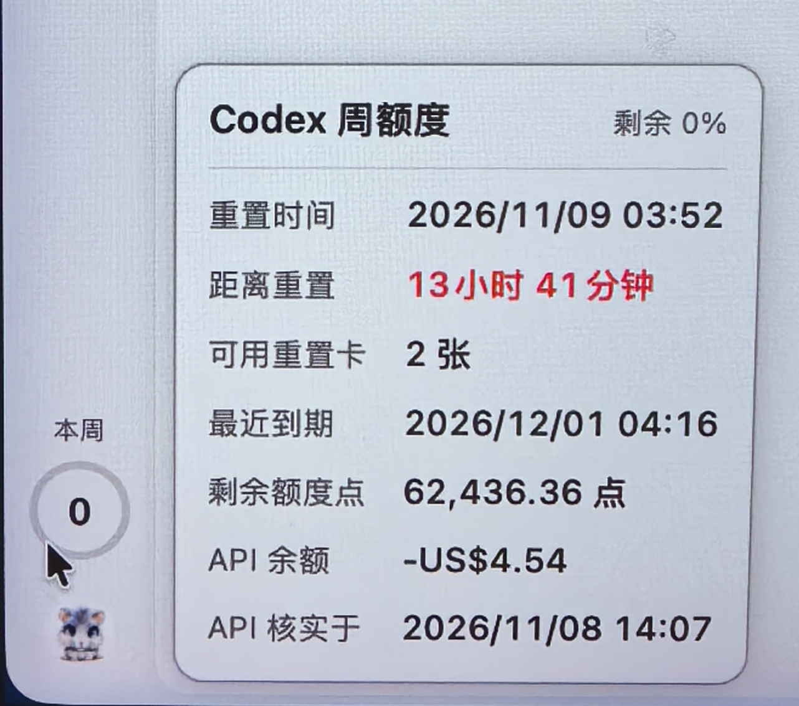

# 额度环 · QuotaRing

macOS 原生 Codex 周额度覆盖层，当前版本 **0.1.5**。把清晰的数字圆环放在 Codex 左侧原用量控件上，鼠标悬停即可查看详细信息。



## 功能

- 圈内只显示剩余额度数字，不带 `%`；“本周”位于圆环上方。
- 悬停卡片显示额度重置时间、剩余倒计时、可用重置卡数量及最近到期时间。时间使用 Asia/Shanghai 时区。
- 卡片另显示 Codex 剩余额度点、API 美元余额及 API 核实时间。点数随额度查询自动刷新；API 余额保留最近一次核实值，只通过菜单栏“同步 API 余额”按需更新。
- 卡片明细不完整时标记“最近到期（已知）”；接口缺失的数据显示“暂不可用”。
- 提供 28、32、36、40、44 五档大小，支持浅色背景、暂停显示和手动刷新。
- 定位后跟随窗口左下角，切换到浏览器等应用后仍显示；按 Codex 窗口层级被其他窗口遮挡，最小化、隐藏或离开当前桌面时隐藏。点击穿透到原控件，点击后暂时隐藏覆盖层，鼠标移出后恢复。

## 环境与构建

当前构建目标为 **Apple Silicon（arm64）、macOS 13 或更新版本**。需要 Xcode Command Line Tools（Swift 编译器、Python 3），以及已登录、支持额度查询接口的 Codex CLI。程序会查找 Codex/ChatGPT 应用内置 CLI 和常见 Homebrew 安装路径。

在项目根目录执行：

```bash
mkdir -p .build
RESEARCH_TMP="$PWD/.build" /bin/bash scripts/build.sh
```

`RESEARCH_TMP` 指定编译临时目录，也可由本机已有的容量受控构建工具提供。构建会执行模型、余额、坐标与窗口选择检查，并在临时目录生成使用测试数据的 `card-preview.png`，再生成根目录下的 `QuotaRing.app` 并进行本地临时签名（ad-hoc）。`.build` 和应用产物不进入 Git。

## 首次运行

1. 将 `QuotaRing.app` 放到固定的应用目录后打开。
2. 点击“定位原控件（5 秒）”，切回 Codex，把鼠标停在原用量控件圆心并等待 5 秒。
3. 从菜单栏的额度环图标打开“定位与设置”，调整大小和背景。

界面缩放或导航布局改变后需要重新定位。窗口边缘空间不足时覆盖层会隐藏，可减小圆环或重新定位。0.1.3 使用系统公开的窗口位置与层级信息，无需辅助功能或屏幕录制授权；更新保留已有定位与显示设置。

## 数据与权限

程序通过本机 Codex CLI 的 stdio app-server，只读调用 `account/rateLimits/read`，复用现有 CLI 登录。正常每 120 秒刷新，失败后退避重试并标明上次数据；悬停倒计时每秒更新。不调用模型、不消费重置卡、不修改 Codex 客户端、不开放调试端口、不扫描会话和项目。

API 余额同步为可选功能，需安装 [ego lite](https://github.com/citrolabs/ego-lite) 并在其中登录 OpenAI Platform。点击“同步 API 余额”后，会打开官方账单页，读取当前所选组织页面显示的美元余额，成功后关闭本次创建的浏览器工作区。只读取页面显示的余额，不索取 API Key、不导出登录凭据、不自动轮询、不修改账单或购买额度。需要登录时会保留页面供用户完成，之后再次点击同步即可。API 余额与核实时间只保存在本机偏好设置中，不随源码发布；失败时保留旧值及原时间。点数与 API 美元余额是两个独立账户口径，不进行换算。

窗口定位只读取窗口编号、所属进程、位置、尺寸及层级等系统元数据，不读取窗口标题、不截屏、不遍历聊天内容。定位采用人工选点。设置保存在本应用的 UserDefaults 中；默认不注册登录启动，退出并删除应用即可停用。

## 检查与限制

```bash
QuotaRing.app/Contents/MacOS/QuotaRing --self-test
QuotaRing.app/Contents/MacOS/QuotaRing --check-data
```

`--self-test` 使用固定测试数据验证模型与坐标计算；`--check-data` 读取当前账户的真实额度，输出额度、时间和卡片数量，不输出账号标识或凭据。真实额度输出属于个人使用信息，请勿随意公开。

`--sync-api-balance` 与菜单中的手动同步相同，会通过 ego lite 读取官方 API 账单页，并更新本机保存的余额和核实时间。

窗口定位、缩放、点击穿透及前后台行为需在实际 Codex 界面中验证，模型检查不能替代界面验收。此项目是独立工具，并非 OpenAI 官方产品；所依赖的 CLI 接口和客户端布局变化可能影响兼容性。

## 许可证

采用 [MIT 许可证](LICENSE)。允许使用、修改、分发及商用，须保留版权与许可声明；软件按现状提供，不提供担保。
